# وثيقة التصميم — نظام معرض قويدر للأدوات والأجهزة المنزلية

> الإصدار 0.1 — بانتظار الاعتماد قبل بدء كتابة الكود.

---

## 1. تحليل المتطلبات

### 1.1 المستخدمون وسياق الاستخدام
| المستخدم | الجهاز الغالب | أهم ما يفعله يوميًا |
|---|---|---|
| صاحب المعرض / مدير المعرض | الهاتف | مبيعات وأرباح اليوم، اعتماد الحوالات، أرصدة الحسابات |
| موظف المبيعات | الهاتف أو جهاز الكاشير | البيع السريع، البحث عن المنتج والكمية، تسجيل الحوالة |
| أمين المخزن | الهاتف | استلام البضاعة، الجرد، تسجيل التالف |
| المحاسب | الكمبيوتر | السندات، المصروفات، كشوف الحسابات، التقارير |

النتيجة: **العمليات اليومية (البيع، البحث، الحوالة، سند القبض) تُصمَّم للهاتف أولًا**، والعمليات الإدارية النادرة تعمل على الهاتف أيضًا لكنها مريحة أكثر على الكمبيوتر.

### 1.2 الوحدات الوظيفية
1. **الكتالوج:** الأصناف، المنتجات، المتغيرات (مقاس/لون/موديل)، وحدات القياس، الماركات، الاستيراد والتصدير من Excel.
2. **المخزون:** المستودعات، الأرصدة، الحركات، الجرد والتسوية، التالف والمفقود، التنبيهات.
3. **المشتريات:** الموردون، فواتير الشراء، مردودات المشتريات، ذمم الموردين.
4. **المبيعات:** نقطة البيع، الفواتير، الدفع المتعدد والجزئي والآجل، المرتجعات، الإلغاء.
5. **المالية:** الحسابات المالية، الحوالات الواردة والتحقق منها، التحويل بين الحسابات، سندات القبض والصرف، المصروفات.
6. **العملاء والذمم:** سجل العملاء، كشف الحساب، تحصيل الديون.
7. **التقارير:** لوحة التحكم، التقارير اليومية والأسبوعية والشهرية والمخصصة، الأرباح والخسائر، التدفق النقدي.
8. **الإدارة:** المستخدمون، الأدوار، الصلاحيات، الإعدادات، سجل التدقيق.

### 1.3 القواعد التي يُبنى عليها كل شيء
1. **لا حذف لأي سجل مالي أو مخزني.** الإلغاء يعني تغيير الحالة إلى «ملغى» مع حركات عكسية موثقة.
2. **لا يتغير أي رصيد إلا عبر حركة.** رصيد الحساب = الرصيد الافتتاحي + مجموع حركاته، ورصيد المخزون = مجموع حركات المنتج، ورصيد العميل أو المورد = مجموع قيوده. الأرصدة المخزنة (Cached) للسرعة فقط، وتُحدَّث داخل نفس المعاملة، ويمكن إعادة احتسابها من الحركات في أي وقت.
3. **كل عملية تؤثر على المخزون أو المال تُنفَّذ داخل معاملة قاعدة بيانات واحدة:** إما أن تنجح كلها أو تفشل كلها.
4. **الاعتماد مرة واحدة فقط:** كل طلب اعتماد يحمل مفتاح منع التكرار (Idempotency Key)، وعليه فهرس فريد في قاعدة البيانات.
5. **الحوالة غير المؤكدة ليست مالًا مستلمًا.**
6. **الربح المحاسبي منفصل عن التدفق النقدي.**

### 1.4 قرارات تحتاج تأكيدك (لها قيم افتراضية مقترحة)
| السؤال | الافتراض المقترح |
|---|---|
| ضريبة القيمة المضافة | **لا توجد** — لا حقول ضريبة في الفواتير ولا في التقارير (معتمد) |
| الطباعة | **A4 فقط** عبر المتصفح، مع حفظ PDF ومشاركة من الهاتف — لا طباعة حرارية (معتمد) |
| طريقة احتساب التكلفة | **المتوسط المرجّح المتحرك** (القسم 4) |
| المخزون السالب | ممنوع دائمًا في الإصدار الأول |
| ترتيب بناء الواجهة | **مع كل وحدة** بدل تأجيلها كلها إلى المرحلة السابعة (القسم 5) |

---

## 2. التقنيات وهيكل المشاريع

### 2.1 التقنيات
| الطبقة | التقنية |
|---|---|
| Backend | ASP.NET Core 9 Web API, C# 13 |
| ORM | Entity Framework Core 9 (SQL Server provider) + Migrations |
| قاعدة البيانات | Microsoft SQL Server 2022 |
| المصادقة | ASP.NET Core Identity + JWT (Access Token قصير العمر + Refresh Token دوّار) |
| التحقق | FluentValidation برسائل عربية |
| التوثيق | Swagger / OpenAPI (Swashbuckle) |
| Excel | ClosedXML |
| PDF | QuestPDF (يدعم العربية وRTL) + طباعة المتصفح للفواتير |
| السجلات | Serilog |
| الاختبارات | xUnit + FluentAssertions + اختبارات تكامل على SQL Server حقيقي (قاعدة اختبار مستقلة) |
| Frontend | React 18 + TypeScript + Vite |
| التنقل | React Router |
| جلب البيانات | TanStack Query (تخزين مؤقت، إعادة المحاولة، إلغاء الطلبات) |
| النماذج | React Hook Form + Zod (رسائل عربية) |
| التنسيق | Tailwind CSS بخصائص منطقية (start/end) لدعم RTL، وخط عربي (IBM Plex Sans Arabic أو Tajawal) مستضاف محليًا |
| الرسوم البيانية | Recharts |
| اختبارات الواجهة | Vitest + Testing Library، وPlaywright لاختبار الشاشات على مقاسات الهاتف والكمبيوتر |

### 2.2 البنية المعمارية (Clean Architecture)
```
Api  ──►  Application  ──►  Domain
 │             ▲
 └──►  Infrastructure ┘
```
- **Domain:** الكيانات والتعدادات وقواعد العمل الصافية (حساب المتوسط المرجح، تحقق السعر الأدنى…) دون أي اعتماد على EF أو ASP.NET.
- **Application:** واجهات الخدمات، الخدمات، DTOs، التحقق، الصلاحيات المنطقية.
- **Infrastructure:** EF Core DbContext، الإعدادات (Configurations)، Migrations، الترقيم، تخزين الملفات، Excel وPDF، Identity وJWT.
- **Api:** Controllers، Middleware لمعالجة الأخطاء الموحدة (ProblemDetails بالعربية)، Swagger، سياسات الصلاحيات.

### 2.3 هيكل المجلدات
```
D:\Qwader\
├── Qwader.sln
├── docs\
│   ├── DESIGN.md                    ← هذه الوثيقة
│   └── API.md
├── src\
│   ├── Qwader.Domain\
│   │   ├── Common\                  (BaseEntity, IAuditable, Money helpers)
│   │   ├── Catalog\                 (Category, Product, Brand, Unit)
│   │   ├── Inventory\               (Warehouse, StockBalance, StockMovement, StockCount)
│   │   ├── Purchasing\              (Supplier, PurchaseInvoice, PurchaseReturn)
│   │   ├── Sales\                   (Customer, SaleInvoice, SaleLine, SalePayment, SaleReturn)
│   │   ├── Finance\                 (FinancialAccount, AccountTransaction, IncomingTransfer,
│   │   │                             AccountTransfer, ReceiptVoucher, PaymentVoucher, Expense)
│   │   ├── Ledgers\                 (CustomerLedgerEntry, SupplierLedgerEntry)
│   │   └── Identity\                (AppUser, AppRole, Permission, AuditLog)
│   ├── Qwader.Application\
│   │   ├── Abstractions\            (IAppDbContext, ICurrentUser, IClock, IFileStorage, INumberGenerator)
│   │   ├── Common\                  (PagedResult, Result, Errors, ArabicText.Normalize)
│   │   ├── Catalog\ Inventory\ Purchasing\ Sales\ Finance\ Customers\ Reports\ Users\ Settings\ Search\
│   │   │     └── (كل وحدة: Dtos\, Validators\, I*Service.cs, *Service.cs)
│   │   └── DependencyInjection.cs
│   ├── Qwader.Infrastructure\
│   │   ├── Persistence\
│   │   │   ├── AppDbContext.cs
│   │   │   ├── Configurations\      (IEntityTypeConfiguration لكل كيان)
│   │   │   ├── Migrations\
│   │   │   └── Seed\                (الأدوار، الصلاحيات، الحسابات الأولية، المستودع، الوحدات)
│   │   ├── Identity\                (JwtTokenService, PermissionHandler)
│   │   ├── Files\                   (LocalFileStorage — خارج wwwroot)
│   │   ├── Exports\                 (ExcelExporter, PdfReportRenderer)
│   │   └── DependencyInjection.cs
│   └── Qwader.Api\
│       ├── Controllers\             (Auth, Categories, Products, Inventory, Purchases, Sales,
│       │                             Customers, Suppliers, Payments, FinancialAccounts,
│       │                             IncomingTransfers, AccountTransfers, ReceiptVouchers,
│       │                             PaymentVouchers, Expenses, Reports, Search, Users, Settings, Files)
│       ├── Middleware\              (ExceptionHandling, Idempotency)
│       ├── Authorization\           (Permissions.cs, HasPermissionAttribute)
│       ├── appsettings.json         (بدون أسرار)
│       └── Program.cs
├── tests\
│   ├── Qwader.UnitTests\            (التسعير، المتوسط المرجح، معادلات الربح)
│   └── Qwader.IntegrationTests\     (البيع، المرتجع، الحوالات، التزامن، الصلاحيات، التقارير)
└── web\                             (React + Vite + TS)
    ├── index.html                   (lang="ar" dir="rtl")
    └── src\
        ├── api\                     (client.ts مع JWT وتجديد التوكن، ودوال لكل وحدة)
        ├── app\                     (router, providers, layout)
        ├── components\
        │   ├── layout\              (TopBar, BottomNav, SideNav, MoreMenu)
        │   ├── ui\                  (Button, Input, MoneyInput, Select قابل للبحث, Sheet, Dialog,
        │   │                         DataList متجاوب: بطاقات على الهاتف وجدول على الكمبيوتر, Pagination, Toast)
        │   └── search\              (GlobalSearch)
        ├── features\
        │   ├── dashboard\ categories\ products\ pos\ sales\ purchases\ inventory\
        │   ├── customers\ suppliers\ accounts\ transfers\ receipts\ payments\ expenses\
        │   └── reports\ users\ settings\ auth\
        ├── lib\                     (formatMoney ₪, formatDate Asia/Hebron, arabicNormalize, permissions)
        └── styles\
```

### 2.4 الأسرار والإعدادات
- سلسلة الاتصال ومفتاح JWT وكلمة مرور المدير الأولى: عبر **User Secrets** في التطوير و**متغيرات البيئة** في الإنتاج. ولا يُحفظ أي سر داخل الكود أو `appsettings.json`.
- أول تشغيل: يُنشأ مستخدم «مدير النظام» بكلمة مرور من المتغير `QWADER_ADMIN_PASSWORD`، ويُطلب منه تغييرها عند أول دخول.

---

## 3. قاعدة البيانات

### 3.1 اصطلاحات عامة
| البند | القرار |
|---|---|
| المبالغ | `decimal(18,2)` |
| تكاليف الوحدة والمتوسط المرجح | `decimal(18,4)` لتقليل أخطاء التقريب |
| الكميات | `decimal(18,3)` (لدعم المتر والكيلو) |
| التواريخ | `datetime2` مخزنة بتوقيت **UTC**. العرض وحدود الأيام في التقارير بتوقيت `Asia/Hebron` |
| المفاتيح | `int IDENTITY` للجداول المرجعية، و`bigint` للحركات |
| التزامن | `rowversion` على الجداول القابلة للتعديل (المنتج، الرصيد، الحساب) |
| الأرشفة | `IsActive`/`IsArchived` بدل الحذف |
| البحث العربي | عمود `NormalizedName` مفهرس يُملأ في التطبيق: توحيد (أ إ آ ← ا)، (ة ← ه)، (ى ← ي)، حذف التشكيل والتطويل، ودمج المسافات |
| التدقيق | `CreatedAt, CreatedById, UpdatedAt, UpdatedById` على الكيانات، وجدول `AuditLogs` للعمليات الحساسة |
| الترقيم | جدول `DocumentSequences` يُقفل الصف المعني (`UPDLOCK, HOLDLOCK`) داخل نفس المعاملة، فلا تتكرر الأرقام ولا تُفقد |

صيغ الأرقام: `INV-2026-000001` (بيع)، `SR-` (مرتجع بيع)، `PUR-` (شراء)، `PR-` (مردود شراء)، `RV-` (سند قبض)، `PV-` (سند صرف)، `TR-` (حوالة واردة)، `AT-` (تحويل بين حسابات)، `EXP-` (مصروف)، `SC-` (جرد).

### 3.2 الجداول

**الكتالوج**
- `Categories` (Id, Code UQ, Name, NormalizedName IX, Description, IsActive)
- `Brands` (Id, Name UQ)
- `Units` (Id, Name — قطعة، علبة، كرتونة، متر، طقم…)
- `Products` (Id, Sku UQ, Barcode UQ مشروط NULL, Name, NormalizedName IX, CategoryId FK, BrandId FK?, UnitId FK, DefaultSupplierId FK?, ParentProductId FK? (للمتغيرات), Size?, Color?, Model?, PurchasePrice, AverageCost, WholesalePrice, RetailPrice, MinSalePrice, ReorderLevel, ImagePath?, IsArchived, CreatedAt, RowVersion)
  - `CHECK (RetailPrice >= 0 AND WholesalePrice >= 0 AND MinSalePrice >= 0)`

**المخزون**
- `Warehouses` (Id, Name, IsDefault) — يُنشأ «المعرض الرئيسي» افتراضيًا.
- `StockBalances` (ProductId + WarehouseId PK, Quantity, RowVersion) مع `CHECK (Quantity >= 0)` كخط دفاع أخير ضد المخزون السالب.
- `StockMovements` (Id bigint, ProductId, WarehouseId, MovementType, Quantity (موجب = وارد، سالب = صادر), UnitCost, BalanceAfter, AverageCostAfter, SourceType, SourceId, SourceNumber, Notes, OccurredAt, UserId)
  - أنواع الحركة: `OpeningBalance, Purchase, PurchaseReturn, Sale, SaleReturn, SaleVoid, Damaged, Lost, CountAdjustmentIn, CountAdjustmentOut, TransferIn, TransferOut`
  - فهارس: (ProductId, OccurredAt) و(SourceType, SourceId)
- `StockCounts` + `StockCountLines` (المتوقع، الفعلي، الفرق) — الاعتماد يولّد حركات تسوية.

**المشتريات والموردون**
- `Suppliers` (Id, Code UQ, Name, NormalizedName IX, Phone IX, Address, Notes, Balance (cached), IsActive)
- `PurchaseInvoices` (Id, Number UQ, SupplierInvoiceNo?, SupplierId, WarehouseId, Date, Status [Draft, Posted, Voided], Subtotal, Discount, Total, PaidAmount, RemainingAmount (محسوب), Notes, IdempotencyKey UQ)
- `PurchaseInvoiceLines` (Id, PurchaseInvoiceId, ProductId, Quantity, UnitCost, LineDiscount, LineTotal, ReturnedQuantity)
- `PurchaseReturns` + `PurchaseReturnLines`
- `SupplierLedgerEntries` (Id, SupplierId, Date, EntryType [Purchase, Payment, Return, Opening, Reversal], Debit, Credit, SourceType, SourceId, SourceNumber)

**العملاء والمبيعات**
- `Customers` (Id, Code UQ, Name, NormalizedName IX, Phone UQ مشروط IX, Address?, Balance (cached), CreditLimit?, IsActive) — يوجد عميل نظامي «زبون نقدي» للبيع دون اسم.
- `SaleInvoices` (Id, Number UQ, Date, CustomerId, CustomerNameSnapshot, CustomerPhoneSnapshot, PriceTier [Retail, Wholesale], Status [Posted, PartiallyReturned, Returned, Voided], Subtotal (إجمالي قبل الخصم), LineDiscountTotal, InvoiceDiscount, Total, PaidAmount (مؤكد), PendingAmount (حوالات بانتظار التحقق), RemainingAmount, TotalCost, SalespersonId, Notes, IdempotencyKey UQ, VoidedAt?, VoidedById?, VoidReason?)
  - فهارس: (Date)، (CustomerId, Date)، (SalespersonId, Date)
- `SaleInvoiceLines` (Id, SaleInvoiceId, ProductId, ProductNameSnapshot, Quantity, UnitPrice, LineDiscount, LineTotal, **UnitCost** (المتوسط المرجح لحظة البيع), ReturnedQuantity, PriceOverrideById?)
- `SalePayments` (Id, SaleInvoiceId, FinancialAccountId, Method [Cash, BankTransfer, Wallet, Card], Amount, IncomingTransferId?)
- `SaleReturns` (Id, Number UQ, SaleInvoiceId, Date, RefundAmount, RefundAccountId?, SettlementType [Refund, ReduceDebt], Reason, IdempotencyKey UQ)
- `SaleReturnLines` (Id, SaleReturnId, SaleInvoiceLineId, Quantity, Condition [Sellable, Damaged], UnitPrice, UnitCost)
- `CustomerLedgerEntries` (Id, CustomerId, Date, EntryType [Sale, Payment, Return, TransferRejected, Opening, Reversal], Debit, Credit, SourceType, SourceId, SourceNumber)

**المالية**
- `FinancialAccounts` (Id, Name, Type [Cash, Bank, Wallet], ProviderName, HolderName?, AccountNumber (مقنّع لمن ليست لديه صلاحية), OpeningBalance, CurrentBalance (cached), IsActive, RowVersion)
  - البيانات الأولية: الصندوق النقدي، جوال بي، بنك فلسطين، بنك القدس، البنك الإسلامي الفلسطيني، بال بي.
- `AccountTransactions` (Id bigint, FinancialAccountId, Date, Direction [In, Out], Amount `CHECK > 0`, BalanceAfter, Category [SaleReceipt, DebtCollection, OtherIncome, SupplierPayment, Expense, SaleRefund, TransferIn, TransferOut, Reversal], SourceType, SourceId, SourceNumber, Description, UserId) — **دفتر الحركات الوحيد للأموال.**
  - فهرس: (FinancialAccountId, Date)
- `IncomingTransfers` (Id, Number UQ, SenderName, NormalizedSenderName IX, SenderPhone, Amount, Channel (جهة التحويل), FinancialAccountId (المستلم), ReferenceNo, TransferDate, ProofFileId?, Status [Pending, Confirmed, Rejected], CustomerId?, SaleInvoiceId?, ReceiptVoucherId?, RecordedById, ReviewedById?, ReviewedAt?, RejectReason?)
  - فهرس فريد على (FinancialAccountId, ReferenceNo) **عند عدم كونها مرفوضة** لمنع تسجيل الحوالة نفسها مرتين.
- `AccountTransfers` (تحويل بين حسابات المعرض: FromAccountId, ToAccountId, Amount, Date, Notes) — يولّد حركتين ولا يدخل في الأرباح.
- `ReceiptVouchers` (Id, Number UQ, Date, PayerName, PayerPhone, CustomerId?, SaleInvoiceId?, Amount, Method, FinancialAccountId, Purpose [DebtCollection, InvoicePayment, OtherIncome], Notes, Status [Posted, Voided], IdempotencyKey UQ, CreatedById)
- `PaymentVouchers` (Id, Number UQ, Date, BeneficiaryName, Amount, Method, FinancialAccountId, Purpose [SupplierPayment, Expense, CustomerRefund, Other], SupplierId?, ExpenseId?, Reference, Notes, Status, IdempotencyKey UQ, CreatedById)
- `ExpenseCategories` (Id, Name UQ, IsActive) — الإيجار، الكهرباء، النقل، الرواتب، الصيانة، الشحن، أخرى.
- `Expenses` (Id, Number UQ, Date, ExpenseCategoryId, Description, Amount, FinancialAccountId, PaymentVoucherId UQ, Status, CreatedById)
- `Attachments` (Id, OwnerType, OwnerId, StoredFileName, OriginalName, ContentType, Size, UploadedById, UploadedAt)

**الهوية والإدارة**
- جداول Identity (`AspNetUsers`, `AspNetRoles`, `AspNetUserRoles`…) + `RefreshTokens`
- `Permissions` (Code UQ, NameAr, Group) و`RolePermissions` (RoleId, PermissionCode)
- `Settings` (Key, Value) — اسم المعرض، العنوان، الهاتف، نسبة الربح الافتراضية، شعار الطباعة.
- `DocumentSequences` (DocumentType + Year PK, LastNumber)
- `IdempotencyRecords` (Key PK, UserId, Endpoint, ResponseStatus, ResponseBody, CreatedAt)
- `AuditLogs` (Id bigint, UserId, Action, EntityType, EntityId, OldValues json, NewValues json, Reason?, IpAddress, OccurredAt) — فهرس (EntityType, EntityId) و(OccurredAt).

### 3.3 مخطط العلاقات (ERD)

```mermaid
erDiagram
    Categories ||--o{ Products : contains
    Brands ||--o{ Products : brands
    Units ||--o{ Products : measures
    Products ||--o{ Products : "variants (ParentProductId)"
    Suppliers ||--o{ Products : "default supplier"

    Products ||--o{ StockBalances : "stock per warehouse"
    Warehouses ||--o{ StockBalances : holds
    Products ||--o{ StockMovements : moves
    Warehouses ||--o{ StockMovements : at
    StockCounts ||--o{ StockCountLines : has

    Suppliers ||--o{ PurchaseInvoices : issues
    PurchaseInvoices ||--o{ PurchaseInvoiceLines : has
    Products ||--o{ PurchaseInvoiceLines : bought
    PurchaseInvoices ||--o{ PurchaseReturns : "returned via"
    PurchaseReturns ||--o{ PurchaseReturnLines : has
    Suppliers ||--o{ SupplierLedgerEntries : ledger

    Customers ||--o{ SaleInvoices : buys
    SaleInvoices ||--o{ SaleInvoiceLines : has
    Products ||--o{ SaleInvoiceLines : sold
    SaleInvoices ||--o{ SalePayments : "paid by"
    FinancialAccounts ||--o{ SalePayments : receives
    IncomingTransfers |o--o| SalePayments : backs
    SaleInvoices ||--o{ SaleReturns : "returned via"
    SaleReturns ||--o{ SaleReturnLines : has
    SaleInvoiceLines ||--o{ SaleReturnLines : "returned line"
    Customers ||--o{ CustomerLedgerEntries : ledger

    FinancialAccounts ||--o{ AccountTransactions : ledger
    FinancialAccounts ||--o{ IncomingTransfers : "received into"
    Customers |o--o{ IncomingTransfers : "sent by"
    FinancialAccounts ||--o{ AccountTransfers : "from / to"
    FinancialAccounts ||--o{ ReceiptVouchers : into
    Customers |o--o{ ReceiptVouchers : pays
    SaleInvoices |o--o{ ReceiptVouchers : settles
    FinancialAccounts ||--o{ PaymentVouchers : "paid from"
    Suppliers |o--o{ PaymentVouchers : "paid to"
    ExpenseCategories ||--o{ Expenses : classifies
    PaymentVouchers ||--o| Expenses : "pays (1:1)"

    AspNetUsers ||--o{ AuditLogs : performs
    AspNetRoles ||--o{ RolePermissions : grants
```


---

## 4. آلية احتساب المخزون والأرباح والأموال

### 4.1 تكلفة المخزون: المتوسط المرجّح المتحرك
تُطبَّق نفس الطريقة باستمرار على كل الحركات:

- **عند الشراء (وارد بتكلفة معروفة):**
  `المتوسط الجديد = (الكمية الحالية × المتوسط الحالي + الكمية الواردة × تكلفة الوحدة الصافية) ÷ (الكمية الحالية + الكمية الواردة)`
  تكلفة الوحدة الصافية = تكلفة الوحدة − نصيبها من خصم الفاتورة (يوزَّع الخصم على البنود نسبةً إلى قيمتها).
- **عند البيع:** لا يتغير المتوسط. تُحفَظ `UnitCost = المتوسط الحالي` في بند الفاتورة. هذه هي تكلفة البضاعة المباعة لهذا البند، ولا تتغير لاحقًا حتى لو تغيّر المتوسط.
- **عند مرتجع البيع (صالح للبيع):** تعود الكمية بتكلفتها الأصلية المحفوظة في البند، ويُعاد احتساب المتوسط بنفس معادلة الوارد.
- **عند مرتجع البيع (تالف):** لا تعود الكمية للمخزون، ويُعكس الإيراد، ويُسجَّل مبلغ التكلفة كـ«خسارة بضاعة تالفة» في تقرير الأرباح والخسائر.
- **عند مردود الشراء:** تخرج الكمية بتكلفة الشراء الأصلية:
  `المتوسط الجديد = (ك × م − ك_مردود × تكلفة_الشراء) ÷ (ك − ك_مردود)`
  (وإن أصبحت الكمية صفرًا يبقى المتوسط الأخير كما هو).
- **التالف والمفقود ونقص الجرد:** تخرج الكمية بالمتوسط الحالي، وتُسجَّل قيمتها خسارة مخزون.
- **زيادة الجرد:** تدخل الكمية بالمتوسط الحالي.

كل حركة تحفظ `BalanceAfter` و`AverageCostAfter`، فيمكن تتبّع تكلفة أي منتج في أي تاريخ.

### 4.2 تنفيذ البيع بأمان (المعاملة والتزامن)
خطوات `POST /api/sales` داخل **معاملة واحدة**:
1. فحص `IdempotencyKey`: إن سبق اعتماد فاتورة بنفس المفتاح تُعاد نفس النتيجة دون تنفيذ جديد. (الواجهة تولّد المفتاح عند فتح الفاتورة، وتعطّل زر الاعتماد أثناء الإرسال.)
2. التحقق من الأسعار: سعر البند ≥ `MinSalePrice` و≥ التكلفة، وإلا يجب أن يملك المستخدم صلاحية `Sales.PriceOverride`، ويُسجَّل ذلك في سجل التدقيق. والخصم يحتاج صلاحية `Sales.Discount` مع حد أعلى من الإعدادات.
3. خصم المخزون بتحديث ذري مشروط لكل بند:
   ```sql
   UPDATE StockBalances SET Quantity = Quantity - @qty
   WHERE ProductId = @p AND WarehouseId = @w AND Quantity >= @qty
   ```
   إن كان عدد الصفوف المتأثرة صفرًا فهذا يعني أن الكمية غير كافية: تُلغى المعاملة كلها وتُعاد رسالة «الكمية المتوفرة من (اسم المنتج) هي X فقط». وبذلك عند بيع آخر قطعة من جهازين في نفس اللحظة **ينجح واحد فقط**. ويبقى قيد `CHECK (Quantity >= 0)` حماية إضافية.
4. توليد رقم الفاتورة من `DocumentSequences`.
5. إدراج الفاتورة والبنود (مع `UnitCost`) وحركات المخزون.
6. معالجة الدفعات (القسم 4.4).
7. قيد الذمة على العميل بالمبلغ المتبقي (إن وُجد).
8. `COMMIT`، ثم إعادة رقم الفاتورة وبيانات الطباعة.

نفس النمط يُطبَّق على المشتريات والمرتجعات والسندات والحوالات.

### 4.3 الإيراد والربح (معادلات التقارير)
تُحسب فقط من المستندات **المعتمدة غير الملغاة** ضمن الفترة (بتوقيت فلسطين):

| المؤشر | المعادلة |
|---|---|
| إجمالي المبيعات | Σ (الكمية × سعر الوحدة) لبنود فواتير الفترة |
| الخصومات | Σ خصومات البنود + خصومات الفواتير |
| مردودات المبيعات | Σ قيمة بنود المرتجعات المعتمدة في الفترة (بالسعر الصافي بعد الخصم النسبي) |
| **صافي المبيعات** | إجمالي المبيعات − الخصومات − مردودات المبيعات |
| تكلفة البضاعة المباعة | Σ (الكمية × UnitCost) لبنود البيع − Σ (الكمية × UnitCost) لبنود المرتجع **الصالحة** |
| **إجمالي الربح** | صافي المبيعات − تكلفة البضاعة المباعة |
| خسائر المخزون | التالف + المفقود + نقص الجرد − زيادة الجرد + تكلفة المرتجعات التالفة |
| المصروفات التشغيلية | Σ `Expenses` المعتمدة في الفترة (**من جدول المصروفات فقط**) |
| **صافي الربح التشغيلي** | إجمالي الربح − المصروفات التشغيلية − خسائر المخزون |

الفاتورة الملغاة تُستبعد بالكامل من الفترة التي أُلغيت فيها، وتبقى ظاهرة في سجل الإلغاءات.

### 4.4 الأموال والذمم: ما الذي يؤثر على ماذا
| العملية | المخزون | حساب مالي | ذمة عميل | ذمة مورد | الأرباح |
|---|---|---|---|---|---|
| بيع نقدي أو تحويل مؤكد | − | + (وارد) | — | — | إيراد + تكلفة |
| بيع آجل (جزئي أو كامل) | − | + بالمدفوع فقط | + بالمتبقي | — | إيراد + تكلفة كاملة |
| بيع بحوالة **بانتظار التحقق** | − | **لا شيء** حتى التأكيد | + بمبلغ الحوالة كـ«قيد التحقق» | — | إيراد + تكلفة |
| تأكيد الحوالة | — | + | − | — | — |
| رفض الحوالة | — | — | تبقى دينًا على العميل + تنبيه | — | — |
| سند قبض (تحصيل دين) | — | + | − | — | **لا شيء** (ليس مبيعات) |
| سند قبض (إيراد آخر) | — | + | — | — | إيراد آخر |
| شراء معتمد | + | − بالمدفوع | — | + بالمتبقي | **لا شيء** (يدخل المخزون) |
| سند صرف لمورد | — | − | — | − | **لا شيء** |
| مصروف (يولّد سند صرف تلقائيًا) | — | − | — | — | مصروف (مرة واحدة من جدول المصروفات) |
| تحويل بين حسابات المعرض | — | − من / + إلى | — | — | **لا شيء** |
| مرتجع بيع باسترداد نقدي | + (الصالح) | − | — | — | − إيراد − تكلفة |
| مرتجع بيع بتخفيض الدين | + (الصالح) | — | − | — | − إيراد − تكلفة |

- **المصروف وسند الصرف:** إنشاء مصروف يولّد سند صرف مرتبطًا به (1:1) وحركة حساب واحدة. تقرير الأرباح يقرأ من `Expenses`، والتدفق النقدي يقرأ من `AccountTransactions`، فلا يُحتسب أي مبلغ مرتين.
- **الحوالة في البيع:** في البيع بحوالة غير مؤكدة يُطلب اسم العميل ورقم جواله (يُنشأ العميل تلقائيًا من رقم الجوال إن لم يكن موجودًا)، حتى يمكن متابعة المبلغ إن رُفضت الحوالة.
- **الدفع المتعدد:** فاتورة واحدة قد تحتوي على عدة دفعات (نقد + جوال بي + بنك…)، ومجموع الدفعات ≤ إجمالي الفاتورة. وإن دفع العميل أكثر من الإجمالي يُعرض المبلغ كـ«باقي للزبون» ولا يُسجَّل.
- **منع الدفعة المكررة:** مفتاح منع التكرار لكل سند، وفهرس فريد على (الحساب، رقم مرجع الحوالة)، وتحذير عند تسجيل سند بنفس المبلغ والدافع والحساب خلال آخر 10 دقائق (يمكن تجاوزه مع ذكر سبب).

### 4.5 الإلغاء والعكس
- **إلغاء فاتورة بيع** (صلاحية `Sales.Void` + سبب إلزامي): إعادة الكميات بحركات `SaleVoid`، وحركات حساب عكسية للمدفوعات المؤكدة، وقيد عكسي لذمة العميل، وتحويل الحوالات المعلقة المرتبطة إلى «مرفوضة» بسبب «إلغاء الفاتورة». لا يُسمح بإلغاء فاتورة عليها مرتجع؛ إذ يجب إرجاع باقي الكمية بدل ذلك.
- **إلغاء سند أو مصروف:** حركة عكسية في الحساب وفي الذمة، والسند يبقى ظاهرًا بحالة «ملغى».
- كل إلغاء يُسجَّل في `AuditLogs` مع المستخدم والتاريخ والسبب.

### 4.6 البحث الموحد
`GET /api/search?q=...&types=...`:
- تطبيع النص (`ArabicText.Normalize`) في الخادم وفي الواجهة بنفس القواعد.
- إن كان النص أرقامًا أو كودًا: مطابقة تامة أو بادئة على SKU والباركود ورقم الفاتورة والسند ومرجع الحوالة والجوال (فهارس مباشرة).
- وإلا: `NormalizedName LIKE @q + '%'` أولًا (يستفيد من الفهرس)، ثم `LIKE '%' + @q + '%'` لإكمال النتائج، بحد 5 نتائج لكل نوع.
- الواجهة: تأخير 250 مللي ثانية أثناء الكتابة، وإلغاء الطلب السابق، والنتائج مجمّعة حسب النوع.
- إن تجاوز عدد المنتجات عشرات الآلاف يمكن لاحقًا تفعيل Full-Text Search دون تغيير الواجهة.

### 4.7 الصلاحيات
صلاحيات دقيقة تُفحص في الخادم بسياسات `[HasPermission("...")]`، والواجهة تخفي ما لا يُسمح به فقط ولا تعتمد عليه للحماية:

`Products.View, Products.ViewCost, Products.Manage, Products.EditPrices, Inventory.Adjust, Inventory.Count, Purchases.Manage, Sales.Create, Sales.Discount, Sales.PriceOverride, Sales.Void, Sales.Return, Transfers.Create, Transfers.Review, Vouchers.Create, Vouchers.Void, Expenses.Manage, Accounts.Manage, Accounts.ViewNumbers, Reports.Sales, Reports.Profit, Reports.Financial, Customers.Manage, Suppliers.Manage, Users.Manage, Settings.Manage, Audit.View`

| الدور | ملخص الصلاحيات |
|---|---|
| مدير النظام | كل الصلاحيات |
| مدير المعرض | كل شيء عدا إدارة المستخدمين والإعدادات الحساسة |
| موظف مبيعات | البيع، تسجيل الحوالة، سند القبض، عرض المنتجات دون التكلفة، خصم محدود |
| أمين مخزن | المنتجات، المخزون، الجرد، المشتريات (بدون مدفوعات) |
| محاسب | السندات، المصروفات، الحسابات، اعتماد الحوالات، التقارير المالية |
| عرض فقط | عرض المنتجات والمخزون والتقارير المسموحة |

الأدوار قابلة للتعديل من شاشة «المستخدمون والصلاحيات».

### 4.8 الملفات المرفوعة
- الأنواع المسموحة: JPG وPNG وWEBP وPDF، بحد أقصى 5 ميغابايت. يُفحص نوع الملف الحقيقي (Magic Bytes) وليس الامتداد فقط.
- تُحفظ خارج `wwwroot` بأسماء عشوائية (GUID)، وتُضغط الصور تلقائيًا (لتسريع الرفع من الهاتف).
- تُعرض فقط عبر `GET /api/files/{id}` بعد التحقق من صلاحية المستخدم على المستند المرتبط.

---

## 5. خطة التنفيذ التفصيلية

**توصية:** أن تُبنى شاشات React **مع كل وحدة** بدل تأجيلها إلى مرحلة منفصلة، لأن معايير القبول (القسم 21) تعتمد على تجربة الهاتف، واكتشاف مشاكل الواجهة مبكرًا أرخص من اكتشافها في النهاية. المرحلة السابعة الأصلية تتحول إلى مرحلة صقل وتحقق.

| # | المرحلة | المخرجات | معيار الإنجاز |
|---|---|---|---|
| 1 | التحليل والتصميم | هذه الوثيقة + ERD | **اعتمادك** |
| 2 | الأساس | الحل والمشاريع الأربعة، EF Core، الترحيل الأول، البيانات الأولية، Identity وJWT وتجديد التوكن، الصلاحيات، معالجة الأخطاء بالعربية، Swagger، سجل التدقيق، الترقيم، مفاتيح منع التكرار. الواجهة: مشروع Vite، التخطيط RTL (الشريط العلوي، التنقل السفلي على الهاتف والجانبي على الكمبيوتر، قائمة «المزيد»)، تسجيل الدخول، مكونات UI الأساسية | تسجيل الدخول من الهاتف يعمل، `dotnet ef database update` ينشئ القاعدة على SQL Server |
| 3 | الكتالوج والمخزون والمشتريات | الأصناف، المنتجات والمتغيرات، الصور، الاستيراد والتصدير من Excel، اقتراح السعر بنسبة الربح، الموردون، فواتير الشراء ومردوداتها، حركات المخزون، الجرد، التالف، التنبيهات، البحث الموحد. الواجهة: بطاقات المنتجات، صفحة المنتج، نموذج الإضافة المقسم، شاشة الجرد | اختبارات المتوسط المرجح والشراء وكشف المورد ناجحة |
| 4 | المبيعات | نقطة البيع، الدفع المتعدد والجزئي والآجل، العملاء والذمم، المرتجعات، الإلغاء، طباعة الفاتورة (A4) ومشاركتها. الواجهة: شاشة البيع اللمسية | اختبارات البيع والتزامن ومنع التكرار والمرتجع ناجحة |
| 5 | المالية | الحسابات، الحوالات ومراجعتها (مع رفع صورة من الكاميرا)، التحويل بين الحسابات، سندات القبض والصرف وطباعتها، المصروفات، كشوف الحسابات | اختبارات الأرصدة والحوالات والسندات ناجحة |
| 6 | التقارير | لوحة التحكم، التقارير اليومية والأسبوعية والشهرية والمخصصة، الأرباح والخسائر، التدفق النقدي، الذمم، أرباح المنتجات، حركة المخزون، والتصدير إلى Excel وPDF | اختبار تقارير الفترات مقابل بيانات معروفة ناجح |
| 7 | صقل الواجهة | مراجعة كل الشاشات على مقاسات 360 و390 و768 و1440 بكسل باستخدام Playwright، والتحقق من معايير القبول الثمانية في القسم 21 | لا تمرير أفقي ولا تداخل نصوص |
| 8 | التسليم | الاختبارات الكاملة، دليل التشغيل، `docs/API.md`، إعداد النشر (IIS أو Docker)، نسخ احتياطي لقاعدة البيانات | كل الاختبارات ناجحة ودليل النشر جاهز |

### قائمة الاختبارات الإلزامية (المرحلتان 3–6)
1. اقتراح سعر البيع حسب نسبة الربح، وحساب الربح المتوقع.
2. المتوسط المرجح عبر سلسلة: شراء ← شراء ← بيع ← مرتجع ← مردود شراء.
3. اعتماد الفاتورة وخصم المخزون وتسجيل حركاته.
4. رفض بيع كمية أكبر من المتوفر، مع التراجع الكامل دون أثر جزئي.
5. بيعان متزامنان لآخر قطعة: ينجح واحد فقط ويبقى المخزون صفرًا.
6. نفس مفتاح منع التكرار مرتين: فاتورة واحدة فقط.
7. الدفع الجزئي والمقسّم على أكثر من حساب.
8. الحوالة: معلقة (لا تغيّر الرصيد) ← مؤكدة (+ رصيد، − ذمة) ← مرفوضة (تبقى دينًا).
9. منع تكرار رقم مرجع الحوالة في نفس الحساب.
10. سند القبض لا يظهر كمبيعات، والمصروف لا يُحتسب مرتين.
11. المرتجع الصالح مقابل التالف، والأثر على الربح والمخزون.
12. إلغاء الفاتورة: كل الحركات العكسية موجودة.
13. أرصدة الحسابات = الرصيد الافتتاحي + مجموع الحركات.
14. التقارير على حدود اليوم بتوقيت فلسطين (عملية في 23:30 بتوقيت فلسطين تقع في يومها الصحيح).
15. الصلاحيات: موظف المبيعات لا يرى التكلفة ولا يلغي ولا يعتمد الحوالات (رد 403).
