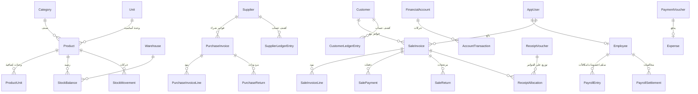

# قاعدة بيانات نظام معرض قويدر

قاعدة البيانات **SQL Server**، تُبنى وتُحدَّث تلقائيًا من الكود (EF Core Migrations) عند تشغيل التطبيق. كل المبالغ بالشيكل (₪)، والتواريخ محفوظة بتوقيت UTC وتُعرض بتوقيت فلسطين.

**قواعد عامة:**
- **لا حذف للمستندات المالية:** الفاتورة أو السند لا يُحذف؛ يُلغى (Status = ملغى) ويُسجَّل عكسه في الحركات.
- **كل رصيد = مجموع حركاته:** رصيد الحساب المالي، دين العميل، مستحقات المورد، كمية المخزون — كلها محفوظة للسرعة، ويمكن إعادة حسابها من جدول حركاتها (هذا ما يفعله «فحص سلامة الحسابات»).
- **أعمدة التدقيق:** أغلب الجداول فيها `CreatedAt / CreatedById / UpdatedAt / UpdatedById` (متى ومن أنشأ وعدّل).
- **العلاقات:** «تقييد» (Restrict) يعني لا يمكن حذف الأصل ما دام له تابع؛ «تتابع» (Cascade) يعني يُحذف التابع مع أصله (مثل بنود الفاتورة)؛ «تفريغ» (SetNull) يعني يبقى التابع ويُفرَّغ الربط.

---

## 1. المستخدمون والصلاحيات والنظام

| الجدول | الوصف | أهم الأعمدة | العلاقات |
|---|---|---|---|
| **AspNetUsers** (AppUser) | مستخدمو النظام (الموظفون). | اسم المستخدم، الاسم الكامل، الجوال، كلمة المرور (مشفّرة)، فعّال، يجب تغيير كلمة المرور، آخر دخول، القفل بعد المحاولات الفاشلة | له أدوار، رموز تجديد، اشتراكات إشعارات، إشعارات، وقد يكون عاملًا في الرواتب |
| **AspNetRoles** (AppRole) | الأدوار (مدير النظام، مدير المعرض، بائع…). | الاسم، الاسم المعروض، الوصف، دور نظامي لا يُحذف | له صلاحيات ومستخدمون |
| **AspNetUserRoles** | ربط المستخدم بأدواره. | المستخدم، الدور | → المستخدم، → الدور (تتابع) |
| **RolePermissions** | صلاحيات كل دور (33 صلاحية مثل «عرض التكلفة»، «تعديل الأسعار»). | الدور، رمز الصلاحية | → الدور (تتابع) |
| **RefreshTokens** | رموز تجديد الدخول (تبقى الجلسة مفتوحة دون كتابة كلمة المرور كل 15 دقيقة). تُحفظ مشفّرة. | المستخدم، بصمة الرمز، الانتهاء، الإلغاء، الرمز البديل | → المستخدم (تتابع) |
| AspNetUserClaims / RoleClaims / UserLogins / UserTokens | جداول قياسية لنظام الهوية في ASP.NET، غير مستخدمة فعليًا. | — | → المستخدم / الدور |
| **Settings** | إعدادات المعرض (الاسم، العنوان، حد الخصم، حد التنبيه الافتراضي، مدة البيع دون اتصال، مفاتيح الإشعارات…). مفتاح ← قيمة. | المفتاح، القيمة، آخر تعديل ومن عدّل | — |
| **DocumentSequences** | عدّادات أرقام المستندات (INV-2026-000123…). صف لكل نوع مستند ولكل سنة. | نوع المستند، السنة، آخر رقم | — |
| **IdempotencyRecords** | يمنع تكرار العملية عند الضغط مرتين أو إعادة الإرسال بعد انقطاع النت: نفس المفتاح يرجع نفس النتيجة. | المفتاح، العملية، نتيجتها (رقم المستند)، المستخدم | — |
| **AuditLogs** | سجل التدقيق: كل عملية حساسة (دخول، تعديل أسعار، إلغاء فاتورة، تصفير…) مع القيم قبل وبعد. | العملية، نوع السجل ورقمه، القيم القديمة والجديدة، السبب، المستخدم، الوقت، IP | — |
| **StoredFiles** | الملفات المرفوعة (صور المنتجات، إثباتات الحوالات، مرفقات السندات والمصروفات). الملف نفسه على القرص، وهنا بياناته. | الاسم الأصلي، النوع، الحجم، الغرض، المسار، من رفعه | يُشار إليه من المنتج والحوالة والسند والمصروف |
| **PushSubscriptions** | أجهزة المستخدمين المشتركة بإشعارات الجوال. | المستخدم، عنوان الجهاز ومفاتيحه، المواضيع المختارة، الجهاز | → المستخدم (تتابع) |
| **UserNotifications** | الإشعارات التي وصلت لكل مستخدم (تظهر في الجرس وشاشة الإشعارات). تُمسح بعد 90 يومًا. | المستخدم، العنوان، النص، الرابط، الموضوع، وقت القراءة | → المستخدم (تتابع) |

## 2. المنتجات والمخزون

| الجدول | الوصف | أهم الأعمدة | العلاقات |
|---|---|---|---|
| **Categories** | أصناف المنتجات (صحون، طناجر…). | الكود، الاسم، الاسم للبحث، فعّال | لها منتجات |
| **Brands** | الماركات. | الاسم | لها منتجات |
| **Units** | وحدات القياس (قطعة، دزينة، كيلو…). | الاسم، فعّال | يستخدمها المنتج ووحداته الإضافية |
| **Products** | المنتجات. | الكود (SKU)، الباركود، الاسم، المقاس/اللون/الموديل، أسعار المفرق والجملة وأقل سعر، **آخر سعر شراء** (معلومة)، **متوسط التكلفة** (لا يغيّره إلا المخزون)، حد التنبيه، الصورة، مؤرشف، نص البحث (`NormalizedName`) و`SearchKey` (نص البحث دون مسافات، محسوب ومفهرس) | → الصنف، → الماركة، → الوحدة الأساسية، → المورد المعتاد، → المنتج الأصلي (للمتغيرات بالمقاس/اللون) — كلها تقييد |
| **ProductUnits** | وحدات بيع/شراء إضافية للمنتج (دزينة = 12 قطعة) بأسعارها. المخزون يبقى بالوحدة الأساسية. | المنتج، الوحدة، **المعامل** (كم قطعة فيها)، أسعار المفرق والجملة وأقل سعر | → المنتج (تتابع)، → الوحدة |
| **Warehouses** | المستودعات (حاليًا «المعرض الرئيسي» الافتراضي). | الاسم، افتراضي، فعّال | — |
| **StockBalances** | **الرصيد الحالي** لكل منتج في كل مستودع. | المنتج، المستودع، الكمية | → المنتج، → المستودع |
| **StockMovements** | **سجل كل حركة مخزون**: افتتاحي، شراء، بيع، مرتجعات، إلغاءات، تالف، مفقود، زيادة، جرد، تصفير عند الأرشفة، تصحيح تكلفة. لا يُعدَّل ولا يُحذف. | المنتج، المستودع، النوع، الكمية (+ دخول / − خروج)، تكلفة الوحدة، **الرصيد بعدها**، **متوسط التكلفة بعدها**، المستند المصدر (نوعه ورقمه)، ملاحظات، المستخدم، الوقت | → المنتج، → المستودع |
| **StockCounts** | مستندات الجرد (مفتوح ← معتمد أو ملغى). يُنشأ أيضًا من استيراد Excel بـ«الكمية الفعلية». | الرقم، المستودع، الحالة، وقت الاعتماد، ملاحظات | → المستودع؛ له بنود |
| **StockCountLines** | بنود الجرد: الكمية المتوقعة (رصيد النظام لحظة الاعتماد) والمعدودة. | الجرد، المنتج، المتوقع، المعدود | → الجرد (تتابع)، → المنتج |

## 3. الموردون والمشتريات

| الجدول | الوصف | أهم الأعمدة | العلاقات |
|---|---|---|---|
| **Suppliers** | الموردون. | الكود، الاسم، الجوال، العنوان، **الرصيد** (ما علينا له)، فعّال | لهم فواتير وكشف حساب |
| **SupplierLedgerEntries** | **كشف حساب المورد**: كل فاتورة شراء، دفعة، مردود، إلغاء، رصيد افتتاحي. | المورد، النوع، مدين، دائن، **الرصيد بعدها**، المستند المصدر | → المورد |
| **PurchaseInvoices** | فواتير الشراء (مسودة ← معتمدة ← ملغاة). البضاعة تدخل المخزون عند الاعتماد فقط. | الرقم، المورد، رقم فاتورة المورد، التاريخ، المجموع، الخصم، الإجمالي، المدفوع وحسابه، الحالة | → المورد، → المستودع، → حساب الدفع |
| **PurchaseInvoiceLines** | بنود فاتورة الشراء. | المنتج، **الوحدة** (قطعة/دزينة) ومعاملها، الكمية، تكلفة الوحدة، خصم البند، الإجمالي، **التكلفة الصافية** (بعد الخصومات — التي تدخل المخزون)، المرتجع منها | → الفاتورة (تتابع)، → المنتج، → وحدة المنتج (تفريغ) |
| **PurchaseReturns** | مردودات المشتريات للمورد. التسوية: خصم من الرصيد أو استرداد نقدي. | الرقم، الفاتورة، المورد، التاريخ، الإجمالي، طريقة التسوية، حساب الاسترداد، السبب | → فاتورة الشراء، → المورد، → حساب الاسترداد |
| **PurchaseReturnLines** | بنود المردود. | بند الفاتورة الأصلي، المنتج، الكمية، التكلفة | → المردود (تتابع)، → بند فاتورة الشراء |

## 4. العملاء والمبيعات

| الجدول | الوصف | أهم الأعمدة | العلاقات |
|---|---|---|---|
| **Customers** | العملاء، ومنهم «زبون نقدي» واحد للبيع النقدي بلا اسم (لا يحمل دينًا). | الكود، الاسم، الجوال، العنوان، **الرصيد** (دينه علينا)، زبون نقدي، فعّال | لهم فواتير وكشف حساب |
| **CustomerLedgerEntries** | **كشف حساب العميل**: فواتير، دفعات، مرتجعات، سندات قبض، إلغاءات، رصيد افتتاحي. | العميل، النوع، مدين، دائن، **الرصيد بعدها**، المستند المصدر | → العميل |
| **SaleInvoices** | فواتير البيع. | الرقم، التاريخ، العميل (واسمه وجواله وقت البيع)، مفرق/جملة، الإجمالي قبل الخصم، الخصومات، الإجمالي، **المدفوع عند البيع**، **المحصّل لاحقًا**، **التكلفة الإجمالية**، البائع، الحالة، بيع دون اتصال، ملاحظة المراجعة | → العميل، → البائع (مستخدم)، → المستودع |
| **SaleInvoiceLines** | بنود فاتورة البيع. | المنتج (واسمه وقت البيع)، **الوحدة** ومعاملها، الكمية، السعر، الخصم، الإجمالي، **الصافي** (بعد حصة خصم الفاتورة)، **تكلفة الوحدة وقت البيع** (لا تتغير)، المرتجع منها، بيع بأقل من التكلفة بصلاحية | → الفاتورة (تتابع)، → المنتج، → وحدة المنتج (تفريغ) |
| **SalePayments** | دفعات الفاتورة عند البيع (نقدي أو أكثر من حساب). | الفاتورة، الحساب، المبلغ، المرجع | → الفاتورة (تتابع)، → الحساب |
| **SaleReturns** | مرتجعات المبيعات. التسوية: خصم من دين العميل أو إعادة المبلغ. | الرقم، الفاتورة، العميل، الإجمالي، التكلفة، التسوية، حساب الإعادة، السبب | → فاتورة البيع، → العميل، → حساب الإعادة |
| **SaleReturnLines** | بنود المرتجع، مع حالة البضاعة (سليمة ترجع للمخزون / تالفة). | بند الفاتورة الأصلي، المنتج، الكمية، الحالة، القيمة، التكلفة | → المرتجع (تتابع)، → بند فاتورة البيع |

## 5. المالية

| الجدول | الوصف | أهم الأعمدة | العلاقات |
|---|---|---|---|
| **FinancialAccounts** | الحسابات المالية: الصندوق النقدي، البنوك، المحافظ الإلكترونية. | الاسم، النوع، الجهة، صاحب الحساب، رقم الحساب، **الرصيد الافتتاحي**، **الرصيد الحالي**، فعّال | لها حركات |
| **AccountTransactions** | **كشف حساب الحساب المالي**: كل مبلغ دخل أو خرج (بيع، تحصيل، دفعة مورد، مصروف، راتب، تحويل، إلغاء…). | الحساب، داخل/خارج، المبلغ، **الرصيد بعدها**، التصنيف، المستند المصدر، المستخدم | → الحساب |
| **AccountTransfers** | التحويل بين حسابين (من الصندوق للبنك مثلًا). | الرقم، من حساب، إلى حساب، المبلغ، التاريخ | → الحسابين |
| **IncomingTransfers** | الحوالات الواردة من العملاء (بانتظار التحقق ← مؤكدة / مرفوضة). المؤكدة فقط تُحسب في الرصيد. | الرقم، المرسل وجواله، المبلغ، الحساب، رقم المرجع، القناة، صورة الإثبات، الحالة، من راجعها وسبب الرفض، الفاتورة، سند القبض | → العميل، → الحساب، → فاتورة البيع |
| **ReceiptVouchers** | سندات القبض (تحصيل دين من عميل أو مقبوضات أخرى). | الرقم، الدافع، المبلغ، الحساب، الغرض، العميل، الفاتورة، الحوالة، الحالة | → العميل، → الحساب، → فاتورة البيع |
| **ReceiptAllocations** | توزيع سند القبض على فواتير العميل (أي فاتورة سدّدها وكم). | السند، العميل، الفاتورة (فارغ = الرصيد الافتتاحي)، المبلغ | → السند، → العميل، → الفاتورة |
| **PaymentVouchers** | سندات الصرف: دفعة لمورد، مصروف، إعادة مبلغ لعميل، سلفة موظف… | الرقم، المستفيد، المبلغ، الحساب، الغرض، المورد/العميل، الحالة | → الحساب، → المورد، → العميل |
| **ExpenseCategories** | تصنيفات المصروفات (كهرباء، إيجار، رواتب…). | الاسم، فعّال | — |
| **Expenses** | المصروفات. كل مصروف يُدفع بسند صرف. | الرقم، التصنيف، الوصف، المبلغ، الحساب، المرفق، الحالة | → التصنيف، → الحساب، → سند الصرف |

## 6. الرواتب

| الجدول | الوصف | أهم الأعمدة | العلاقات |
|---|---|---|---|
| **Employees** | العمال في الرواتب؛ كل عامل مستخدم في النظام. | المستخدم، طريقة الدفع (يومي/أسبوعي/شهري)، الأجر، تاريخ البدء، فعّال | → المستخدم |
| **PayrollEntries** | حركات العامل: **سلفة** (دين عليه حتى المخالصة)، **خصم**، **مكافأة**. | العامل، النوع، المبلغ، التاريخ، الحالة، سند الصرف (للسلفة)، المخالصة التي سوّتها، السلفة المرحّلة | → العامل، → سند الصرف، → المخالصة |
| **PayrollSettlements** | مخالصة الراتب: الأجر × الوحدات + المكافآت − الخصومات − السلف = الصافي، يُدفع من حساب. | الرقم، العامل، الفترة، الوحدات، الأجر، الإجمالي، السلف والخصومات والمكافآت، الصافي، الحساب، السلفة المرحّلة، الحالة | → العامل، → الحساب، → المصروف |

---

## مخطط العلاقات الرئيسية

## كيف تترابط العملية الواحدة (مثال: فاتورة بيع آجل بجزء نقدي)

1. **SaleInvoices** + **SaleInvoiceLines** + **SalePayments**: الفاتورة وبنودها ودفعتها.
2. **StockMovements** (بيع، كمية سالبة بتكلفة الوحدة) و**StockBalances** (الرصيد ينقص).
3. **AccountTransactions** (المبلغ النقدي دخل الصندوق) و**FinancialAccounts.CurrentBalance** يزيد.
4. **CustomerLedgerEntries** (الفاتورة مدين، والمدفوع دائن) و**Customers.Balance** يزيد بالباقي.
5. **AuditLogs** (سطر «فاتورة بيع») و**DocumentSequences** (رقم الفاتورة) و**IdempotencyRecords** (منع التكرار).
6. إشعار «بيع جديد» للمشتركين في **UserNotifications** وأجهزتهم في **PushSubscriptions**.

كل ذلك في **معاملة واحدة**: إما يُحفظ كله أو لا شيء.
